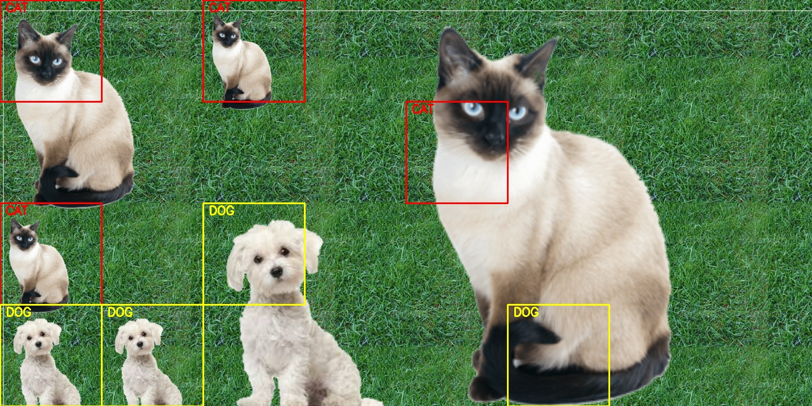

# Lab 4 – Detekcija pasa i mačaka pomoću GoogLeNet mreže

Program pronalazi pse i mačke na slici i obeležava ih pravougaonicima. Koristi se unapred istrenirana konvoluciona neuronska mreža **GoogLeNet** (ImageNet, 1000 klasa), učitana preko OpenCV DNN modula, u kombinaciji sa tehnikom **kliznog prozora** (sliding window).



## Kako radi

1. **Učitavanje slike i modela** – slika se učitava pomoću OpenCV-a, a GoogLeNet model iz Caffe formata (`.prototxt` + `.caffemodel`).
2. **Izdvajanje oblasti od interesa (ROI)** – iz originalne slike se iseca centralni deo dimenzija 1440×720 piksela.
3. **Klizni prozor** – ROI se deli na prozore veličine 180×180 piksela. Svaki prozor se:
   - pretvara u blob dimenzija 224×224 uz oduzimanje srednjih vrednosti kanala (104, 117, 123), kako mreža očekuje,
   - propušta kroz mrežu, koja vraća verovatnoće za svih 1000 ImageNet klasa.
4. **Mapiranje klasa** – ImageNet sadrži 118 rasa pasa (klase 151–268) i nekoliko vrsta mačaka (klase 281–285). Ako najverovatnija klasa pripada jednoj od ovih grupa i pouzdanost je iznad praga (30%), prozor se označava kao **DOG** ili **CAT**.
5. **Vizuelizacija** – detekcije se iscrtavaju na slici (žuto za pse, crveno za mačke), a rezultat se čuva u `output.jpg`.

## Tehnologije

- Python
- OpenCV (`cv2.dnn`) – učitavanje i izvršavanje neuronske mreže
- NumPy
- GoogLeNet (BVLC, istreniran na ImageNet skupu podataka)

## Pokretanje

1. Instalirati biblioteke:
   ```
   pip install opencv-python numpy
   ```
2. Preuzeti težine modela `bvlc_googlenet.caffemodel` (oko 50 MB, nije uključen u repozitorijum zbog veličine) sa zvanične Caffe stranice i staviti ga u ovaj folder:
   http://dl.caffe.berkeleyvision.org/bvlc_googlenet.caffemodel
3. Staviti ulaznu sliku kao `input.png` i pokrenuti:
   ```
   python lab4.py
   ```

## Parametri

| Parametar | Vrednost | Opis |
|---|---|---|
| `WIN_W`, `WIN_H` | 180 | Veličina kliznog prozora |
| `STEP_SIZE` | 180 | Pomeraj prozora (prozori se ne preklapaju) |
| `CONFIDENCE_THRESHOLD` | 0.30 | Minimalna pouzdanost za prihvatanje detekcije |

## Moguća unapređenja

- Preklapajući prozori i više razmera (image pyramid) uz Non-Maximum Suppression, za preciznije lokalizovanje.
- Prikaz konkretne rase psa (top-3 predviđanja) korišćenjem naziva klasa iz `synset_words.txt`.
- Zamena kliznog prozora modernim detektorom objekata (npr. YOLO) za veću brzinu.
